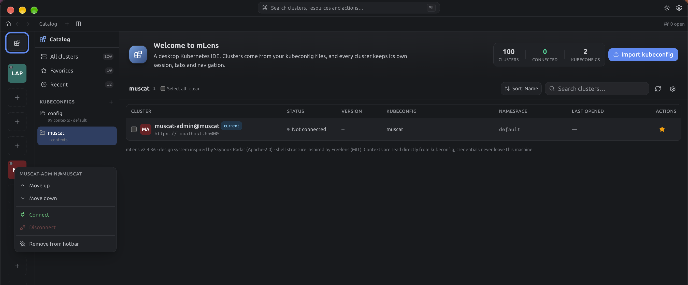

# mLens

**mLens is an independent desktop Kubernetes IDE.** One Electron app written
entirely in TypeScript and React — no Go backend, no separate server, no Docker,
and no Node.js, kubectl or Helm installation required by end users.




Some conventions of desktop Kubernetes tooling (a cluster hotbar, tabbed
resources, a bottom terminal dock) are common to the category; mLens implements
its own shell, data layer and UI. See
[Licensing and credits](#licensing-and-credits).

- Full rules: [`DESIGN_SPEC.md`](DESIGN_SPEC.md) · internals:
  [`ARCHITECTURE.md`](ARCHITECTURE.md) · release history:
  [`CHANGELOG.md`](CHANGELOG.md) · contributor rules: [`AGENTS.md`](AGENTS.md).

---

## Highlights

- **Multi-cluster by design.** Each cluster gets an isolated session with its own
  Kubernetes client, auth context, namespaces, table state, editor tabs and
  terminal PTYs. Switching clusters never disconnects the previous one.
- **Cross-cluster split screen.** The Columns2 button in the cluster strip pins a
  second open cluster beside the active one — two full workspaces with a
  draggable divider. Useful for comparing two environments side by side.
- **VS Code-like editor area.** Resources open as tabs in a resizable area to the
  right of the table: 1–4 panes in a 2×2 grid, per-pane tab strips with
  drag-to-reorder, drag between panes, middle-click close, Close others / Close
  to the right, Split right / Split down, and a per-pane overflow menu.
- **Radar-density tables.** 44px rows, uppercase 12px headers, status language,
  per-column filters, regex search, pinned columns, virtualised rows and paged
  loading for very large inventories.
- **Real Kubernetes, directly.** Discovery, CRDs and printer columns, watches,
  logs, exec, port forwarding over the Kubernetes WebSocket protocol, YAML
  apply, scale/restart/pause/suspend, Node drain and debug shells.
- **No mock data.** If the API, metrics-server or a permission is unavailable,
  the UI says so; missing metric samples render `–`, never invented values.

---

## Getting started

### Requirements (development)

- Node.js 22+
- pnpm 10+ (npm also works, but the lockfile is pnpm)
- Xcode command line tools on macOS (for the node-pty prebuilt check)

```bash
pnpm install
node node_modules/electron/install.js
pnpm dev
```

### macOS sign

```bash
xattr -c /Applications/mLens.app
```

`pnpm install` runs `scripts/postinstall.cjs`, which self-heals two known issues:
node-pty's bundled `spawn-helper` missing its executable bit (some installers
skip node-pty's own postinstall; without it terminals fail with
`posix_spawnp failed`) and a missing Electron runtime (see below).

#### Electron runtime

`electron` is a dev dependency, but its npm package only contains the launcher —
the ~100 MB platform binary is downloaded by the package's own postinstall into
`node_modules/electron/dist` (plus `path.txt`). pnpm v12 blocks install scripts
by default, so `pnpm-workspace.yaml` lists `electron` under `allowBuilds`.

A missing runtime is healed automatically: `pnpm install` runs
`scripts/postinstall.cjs`, which checks `node_modules/electron/path.txt` and
`dist/` and, if either is missing, runs `node node_modules/electron/install.js`
for you (~100 MB, cached in `~/Library/Caches/electron` on macOS after the first
download). A fresh clone + `pnpm install` therefore no longer ends in the
cryptic `Error: Electron uninstall` from electron-vite.

The failure can still happen — set `ELECTRON_SKIP_BINARY_DOWNLOAD` to skip the
heal, or run it offline. In that case `pnpm install` fails loudly with
instructions, or `pnpm dev` dies with:

```
Error: Electron uninstall
    at getElectronPath (... electron-vite/dist/chunks/lib-*.js ...)
```

Fix it manually (needs network):

```bash
node node_modules/electron/install.js   # downloads the runtime for this platform
pnpm dev
```

Or force the whole install/rebuild path:

```bash
pnpm rebuild electron
# or
rm -rf node_modules && pnpm install
```

Check the result: `node_modules/electron/path.txt` must exist and point at the
platform binary (on macOS `Electron.app/Contents/MacOS/Electron`). Behind a
corporate proxy or offline, set `ELECTRON_MIRROR` / `ELECTRON_GET_USE_PROXY`
before running the installer. A copied `node_modules` tree is not portable across
OSes or CPU architectures — after moving the project, prefer a fresh
`pnpm install`.

### Build

```bash
pnpm typecheck     # tsc for main/preload/shared and renderer
pnpm build         # typecheck + electron-vite production build
pnpm dist:mac      # DMG + ZIP (arm64/x64)
pnpm dist:win      # NSIS installer
pnpm dist:linux    # AppImage + deb
```

`electron-builder` packs Electron, the renderer, the TypeScript main process and
node-pty prebuilds into a normal desktop installer. Nothing else is required at
runtime. macOS builds are unsigned by default; when running a locally built DMG,
use right-click → Open the first time.

### Project layout

```
src/main          Electron main: kubeconfig, discovery, watch, logs, exec, pty
src/preload       contextBridge API (window.mlens)
src/shared        types + IPC contract shared by both sides
src/renderer
  app-shell       window chrome, cluster tabs, hotbar, workspace split
  features        catalog, sidebar, browser, editor area, details, terminal, settings
  design-system   tokens and UI primitives
  stores          Zustand catalog + session state
```

---

## Features

### Clusters and catalog

- Discovers contexts from `~/.kube/config` and the `KUBECONFIG` environment
  variable; additional sources can be imported at any time.
- **Import any kubeconfig file**, not just files named `.kubeconfig`: the picker
  offers *All files*, then the content is parsed and validated. Files with
  invalid YAML or no Kubernetes contexts are rejected, and each skipped file is
  reported with its own error while valid files are still added.
- Paste a kubeconfig as YAML; it is validated, written with `0600` permissions
  under the app data directory and added to the catalog.
- Catalog views: All clusters, Favorites, Recent, Removed, and one entry per
  kubeconfig source. Multi-select supports adding favourites and non-destructive
  removal (kubeconfig files are never modified); removed clusters can be restored.
- The catalog sort (open/status, name, recent, source) is remembered across
  restarts. The **Recent** view always lists the most recently opened clusters.
- Cluster tabs, concurrent sessions, and a connecting screen with a real
  three-step checklist (API → namespaces → discovery), percentage and Cancel.
- Per-cluster **Overview**: nodes ready, pod/workload counts, warning events,
  CPU/memory capacity, API/CRD surface and quick links into kinds.

### Workspace, tabs and hotbar

- **Cross-cluster split screen** (Columns2 next to the cluster tabs): open a
  second cluster beside the active one, drag the divider (20–80%), close the
  split from the chip. Closing either pane promotes the other.
- **Editor area** beside the table, starting under the full-width toolbar:
  - 1–4 panes in a 2×2 grid, resizable on the left edge (down to a 240px table).
  - Per-pane tab strips: drag to reorder, drop onto another pane to move,
    middle-click or context menu to close, Close others/right, Split
    right/down, overflow menu.
  - Per-pane inner tabs (Overview/Details/YAML/Events/Related/Logs/Metrics) and
    a 25-entry Back history.
  - Expand over the table, or minimize to the shadow tray above the terminal —
    every tab stays open.
- Cluster tabs use the same tab shape as editor tabs and keep a health LED;
  the hotbar tooltip repeats the status (Connected / Connecting… / Connection
  error / Not connected).
- Hotbar with 10 slots per page, multiple pages (up to 12), drag/context-menu
  repositioning, seeded solid colours and three-letter short names. A favourite
  added from the catalog lands on the **active page**.
- Command palette (`⌘K`/`Ctrl+K`) for clusters, resources and actions, `g`-prefix
  letter navigation, and a `?` shortcut overlay.
- Bottom terminal dock: local shells and pod exec/attach, plus the multi-document
  YAML editor.

### Resource browser

- Dynamic API discovery including CRDs and their printer columns. Default
  columns end with **Status** then **Age** (a CRD's own Age column is dropped,
  never duplicated).
- Tables support live watches and polling with a freshness indicator, counts,
  debounced search with regex, sorting, per-column filters, namespace scope,
  pinned columns, drag-to-resize columns (double-click to reset), column
  visibility/order, and keyboard navigation.
- Column widths and sorting are remembered **per kind tab**
  (`<apiVersion>|<kind>`), so each resource view keeps its own layout across
  clusters and restarts. Legacy widths from earlier versions are still honoured.
- Large inventories are paged: the footer shows `N of M loaded` and an accent
  **Load 2000 more (N left)** chip; the table renders only visible rows
  (virtualised). Search or a column filter auto-loads the remaining pages, so a
  name beyond the first page is still found. Sidebar counts are lazy.
- Kubernetes-aware cells: Pod container squares, Node CPU/Memory bars against
  allocatable, node pod counts, Redis-style condition/taint tooltips, live
  Service endpoints, ConfigMap size, Secret type/TLS expiry, Role subjects,
  CRD kind/status, warning-event counts, and exact age tooltips everywhere.
- Multi-select with bulk actions: delete, saved labels/annotations (selection is
  kept after applying), copy names, and **Diff** — a side-by-side Monaco YAML
  comparison of two resources of the same kind.
- **Compare across clusters**: pin a resource from the row menu, then choose
  "Compare with selected" on a resource in another cluster; the pinned side
  survives cluster switches.
- Row actions: details, edit YAML, logs, exec/attach (Pods), scale, restart,
  pause/resume rollout, suspend/resume and trigger (Jobs/CronJobs), set image,
  cordon/uncordon, drain and debug shell (Nodes), copy kubectl command, delete
  and force delete.
- Custom resources are first-class: sidebar group per API group, printer
  columns, and create/edit from YAML with server-side dry-run.

### Resource details

- Each editor pane shows Overview / Details / YAML / Events / Related /
  Logs (Pods only) / Metrics, with kind actions in a right-aligned row under the
  resource name.
- **YAML** hides server-managed metadata by default (`uid`, `resourceVersion`,
  `generation`, `creationTimestamp`, `managedFields`, `selfLink`) behind an
  "Ignore server metadata" toggle; Apply still merges live metadata and the
  correct resourceVersion.
- **Events** are real Kubernetes events for the object; **Related** lists owners,
  selectors, services, mounted config, node pods and volumes, with clickable
  references.
- Status badges and condition cards explain themselves through tooltips with
  conditions sorted newest-first, reason/message, relative age and the exact
  `lastTransitionTime`.
- **Helm releases** are synthetic rows parsed from `owner=helm` Secrets — no Helm
  binary required. The drawer shows the revision timeline (view any revision,
  compare manifests/values as a Monaco diff, rollback), stored release notes,
  hooks and the resources a manifest creates. Install/upgrade from a chart is
  intentionally absent (it needs Helm's Go template engine).

### Terminal, logs and port forwarding

- Logs are Pod-only, virtualised (up to 20,000 lines) with streaming, container
  picker and follow mode.
- xterm.js terminal with real pod exec over the exec WebSocket, TTY resize,
  search, copy/paste and per-theme ANSI palettes.
- Port forwarding over the Kubernetes WebSocket protocol (no kubectl process),
  one loopback port per forward. The start dialog has **Open in browser after
  starting** (on by default); the one-click Forward action honours the same
  preference. The Port forwards panel lists and stops active forwards.

### Themes and settings

- Themes: Radar (light/dark/system), Dracula, Freelens, Proton, Synthwave '84,
  Dark Islands, GitHub, Night Owl, Material, One Dark Pro, One Dark, Catppuccin
  (Mocha), Jellybeans, Adwaita — each with its own editor theme and terminal
  palette.
- UI font (DM Sans / Ubuntu / System UI), font scale, terminal font and size,
  editor font/size/minimap/tab size, local or UTC time, table row height
  (24–52px), syntax-highlighted YAML editor and configurable refresh interval.

---

## Security

- `sandbox: true`, `contextIsolation: true`, `nodeIntegration: false`.
- The renderer gets a fixed, typed API — never `ipcRenderer` or filesystem access.
- Kubeconfig credentials, exec plugins, TLS material and PTYs stay in the main
  process.
- Strict CSP; popups are denied; HTTP(S) links open in the OS browser.
- Pasted and imported kubeconfigs are validated; pasted copies are written with
  `0600` permissions under the app data directory.
- Cluster removal only hides entries from the catalog; it never rewrites or
  deletes a kubeconfig file.

---

## Known limitations

- No extension system, topology, historical metrics or GitOps-specific views.
  CRDs (including Argo/Flux) appear as generic resources under Custom Resources.
- Port forwarding is TCP loopback (127.0.0.1), one port per forward, no UDP.
- A kubeconfig that authenticates through an `exec` plugin (`kubectl oidc-login`,
  `aws`, `gke-gcloud-auth-plugin`, …) needs that binary installed — mLens never
  ships or runs kubectl itself, but it augments PATH with `/etc/paths`, Homebrew
  and the login shell so such plugins resolve.
- Metrics are live metrics-server values only; no historical Prometheus charts.
- Write actions are not pre-filtered by RBAC; the Kubernetes error is shown when
  an action is denied.
- No automated test suite yet; the app is validated by typechecking, production
  builds and manual smoke tests against real clusters.

---

## Licensing and credits

mLens is MIT licensed — see [`LICENSE`](LICENSE).

mLens is an independent project. It is **not affiliated with, endorsed by, or a
fork of Freelens, Lens, Skyhook or the Cloud Native Computing Foundation**, and
it contains no source files from those projects.

- Workflow conventions common to desktop Kubernetes IDEs (cluster hotbar, tabbed
  resources, details drawer, bottom dock) are reimplemented from scratch.
- The visual design adapts ideas from **Skyhook Radar** (Apache-2.0); the Apache
  licence text is included in [`licenses/Apache-2.0.txt`](licenses/Apache-2.0.txt).
- **Freelens** (MIT) is mentioned only as a design reference for desktop-IDE
  conventions; its licence text is in
  [`licenses/Freelens-MIT.txt`](licenses/Freelens-MIT.txt).
- Fonts: DM Sans and DM Mono (OFL 1.1) via `@fontsource`; Ubuntu and Ubuntu Mono
  (Ubuntu Font Licence 1.0) are bundled under `licenses/`.
- Full third-party notices: [`THIRD_PARTY_NOTICES.md`](THIRD_PARTY_NOTICES.md).
